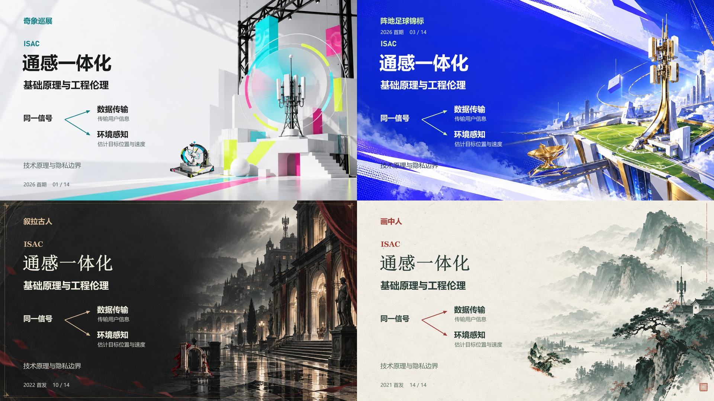

# 明日方舟活动主题 PPTmaker

一个对话式 Codex skill：上传 DOCX、图片等资料，选择想模仿的《明日方舟》活动主题，回答总页数和图文比重，生成混合分层的可编辑 PowerPoint。

**14 个活动主题 · imagegen 背景与装饰 · 原生可编辑文字 · 可移动图片图层**



[查看全部主题预览](docs/theme-gallery.jpg) · [主题配方目录](references/themes.md) · [Skill 入口](SKILL.md)

## 如何使用

将整个仓库文件夹安装为 `arknights-pptmaker` skill，随后在 Codex 对话中直接发送资料：

```text
$arknights-pptmaker 生成 PPT
```

未指定主题时，助手会列出全部可选活动及简短视觉说明，按编号或名称选择。主题确定后，再确认包含封面和结尾的总页数，以及文字/图片比重；已明确的信息不重复询问。

也可以一次给出完整需求：

```text
$arknights-pptmaker 用孤星风格，把上传的资料做成 12 页，图文均衡
```

```text
$arknights-pptmaker 用叙拉古人风格制作课程汇报，16 页，文字多一些
```

助手负责配图、装饰和版式。资料内容决定画面题材，活动设计决定颜色、构图和材质；背景、透明装饰与必要插画会实际调用当前会话的 imagegen 创作。

## 安装

下载 [最新 Release](https://github.com/swindollsahazw1334-ux/arknights-pptmaker/releases/latest) 的安装包，解压后把 `arknights-pptmaker` 文件夹放到 `~/.codex/skills/`。也可放到支持的 `~/.agents/skills/` 目录。

使用 Git 安装到默认 Codex 目录：

```powershell
git clone https://github.com/swindollsahazw1334-ux/arknights-pptmaker.git "$HOME/.codex/skills/arknights-pptmaker"
```

已有同名目录时先备份；Git 安装完成后可在该目录运行 `git pull` 更新。安装后重新开启会话或刷新技能列表。

## 可选择的主题

| 活动 | 配方默认版本 | 视觉特点 |
| --- | --- | --- |
| [奇象巡展](references/themes/interactive.md) | 2026 首期 | 白色展陈、三维构件与荧光点色 |
| [直到大地变成一颗酸橙](references/themes/orange.md) | 2026 首发 | 蓝天、公路旅行与手作笔记 |
| [阵地足球锦标](references/themes/football.md) | 2026 首期 | 蓝紫色赛事包装与绿色场地 |
| [众生行记](references/themes/witnesses.md) | 2025 首发 | 冷白建筑图纸与蓝色精细构造 |
| [矢量突破](references/themes/vector.md) | 初代 2024 | 灰白底、紫色矢量与酸黄色斜角 |
| [促融共竞](references/themes/icebreaker.md) | #1 | 白色竞技空间与红青绿环带 |
| [不义之财](references/themes/blacksteel.md) | 2023 首发 | 黑钢工业、酸黄警戒与城市纪实 |
| [火山旅梦](references/themes/so-long-adele.md) | 2023 首发 | 粉色云海、暖纸与轻快旅行印刷品 |
| [孤星](references/themes/lone-trail.md) | 2023 首发 | 暖纸档案、橙带与多色色签 |
| [叙拉古人](references/themes/siracusano.md) | 2022 首发 | 黑白城市、剧院叙事与少量暗红 |
| [日暮寻路](references/themes/wanderer.md) | 2022 首发 | 麦田、厚云与黄昏印刷品 |
| [长夜临光](references/themes/near-light.md) | 2021 首发 | 现代骑士竞赛、霓虹都市与晨光 |
| [多索雷斯假日](references/themes/dossoles.md) | 2021 首发 | 都市海滨、钴蓝涂绘与彩色贴纸 |
| [画中人](references/themes/who-is-real.md) | 2021 首发 | 纸白、矿物墨绿与朱砂 |

矢量突破当前内置初代配方，促融共竞当前内置 #1 配方；其他期数的官方身份来源已部分收录，但视觉仍需单独研究。每个主题附单页分层设计预览，不代表完整长稿的所有页型都已验证。

## 编辑能力与运行条件

- 重新排版的标题、正文、标签、页码和图注使用原生文字。
- 数据表、数据图和表达信息的关系线按资料制作，保留可编辑结构。
- 生图背景、透明装饰、插画和资料照片分别放置。装饰可移动，但图片内部的笔触仍是像素。
- 照片、截图里的原始像素文字不会自动变成文本框；需要时单独识别重建。

需要具备文件读写、imagegen 和 PPTX 制作能力的助手环境。Codex 桌面内置图片工具不要求另配 API 密钥；其他客户端的工具可用性取决于其配置。本项目提供的是 skill 与辅助脚本，不是独立运行的 AI 网站或自动生图服务。

如果仅安装 skill 并使用助手现有的演示稿工具，无需启动服务。要单独运行附带的导出 helper，需要 Python 3.10+、Node.js 22.12+ 及 Node 依赖：

```powershell
npm ci
npm test
```

辅助脚本只负责资料解析和场景导出，主题设计与生图由助手完成。详细格式见 [production.md](references/production.md)。

```powershell
python scripts/sources.py extract --out work/source.json input.docx
node scripts/export.mjs --scene work/scene.json --out work/result.pptx
python scripts/sources.py inspect work/result.pptx
```

测试覆盖 DOCX 正文/表格/图片读取、数字换行边界、PPTX 原生文字和独立图层、来源备注以及总页数约束。结构检查不能替代实际排版检查；生成稿仍应逐页查看。

## 参考与项目关系

设计研究主要参考 [明日方舟设计收录](https://www.ignoredone.space/index.php/arknights_design/) 和各主题配方中链接的官方活动资料。公开包通过来源链接查看游戏设计参考，随包预览采用原创生图与教学示例排版。详见 [NOTICE.md](NOTICE.md)。

本项目为非官方工具。源码与说明目前未指定开源许可证。
